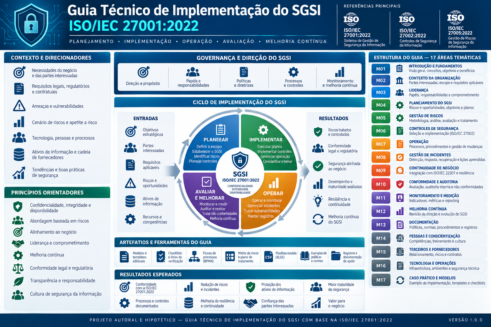

# Guia Técnico de Implementação do SGSI — ISO/IEC 27001:2022

**Projeto autoral de referência para planejamento, implementação, operação, avaliação e melhoria de um Sistema de Gestão de Segurança da Informação (SGSI), com foco em gestão de riscos, controles de segurança, documentação e preparação para certificação.**

> **Natureza do projeto:** conceitual, educacional e profissional. Este repositório não representa a implementação de um SGSI em uma organização real nem declara conformidade ou certificação organizacional.

## 1. Sobre o projeto

Este projeto tem como objetivo desenvolver um guia técnico para profissionais que desejam compreender e estruturar a implementação de um Sistema de Gestão de Segurança da Informação (SGSI) baseado na ISO/IEC 27001:2022.

O repositório reúne documentos de referência, metodologia de implementação, orientações de governança, gestão de riscos, controles de segurança, políticas, procedimentos e modelos de registros reutilizáveis.

O desenvolvimento considera a rastreabilidade entre requisitos normativos, riscos, controles, documentos, responsabilidades e evidências, buscando manter coerência entre governança, planejamento, operação, monitoramento, auditoria e melhoria contínua.

O material destina-se a profissionais de Segurança da Informação, GRC (*Governance, Risk and Compliance*), gestão de riscos, auditoria, infraestrutura, operações de TI e consultoria.

## 2. Objetivos

- Explicar os requisitos da ISO/IEC 27001:2022 e sua aplicação na estruturação de um SGSI.
- Organizar uma metodologia de implementação por etapas, entregáveis e dependências.
- Desenvolver modelos documentais reutilizáveis, acompanhados de orientações de preenchimento e revisão.
- Relacionar requisitos normativos, riscos, controles, políticas, procedimentos e evidências.
- Estruturar a avaliação de riscos de Segurança da Informação e o Plano de Tratamento de Riscos.
- Orientar a elaboração da Declaração de Aplicabilidade (*Statement of Applicability* — SoA).
- Abordar controles organizacionais, de pessoas, físicos e tecnológicos.
- Definir práticas de monitoramento, medição, auditoria interna e melhoria contínua.
- Apoiar a organização documental e a preparação para auditorias externas de certificação.
- Apresentar exemplos conceituais que possam ser adaptados a diferentes contextos organizacionais.

## 3. Escopo

O guia contempla o ciclo de vida de um SGSI, desde a governança e o planejamento inicial até a preparação para certificação e a manutenção do sistema de gestão.

Os domínios documentais incluem:

- Fundamentos do SGSI e referências técnicas.
- Governança e planejamento do projeto.
- Contexto organizacional, partes interessadas e definição do escopo.
- Liderança, política de Segurança da Informação e responsabilidades.
- Gestão de riscos e tratamento de riscos.
- Declaração de Aplicabilidade e justificativas de seleção dos controles.
- Estrutura de gestão dos controles de segurança.
- Políticas, procedimentos e informação documentada.
- Gestão de pessoas, competências e conscientização.
- Planejamento e controle operacional.
- Monitoramento, indicadores e avaliação de desempenho.
- Auditoria interna.
- Análise crítica pela direção, não conformidades e melhoria contínua.
- Preparação para certificação.
- Modelos, formulários, registros e instrumentos de apoio.
- Referências técnicas e glossário.

A seleção e a aplicação de controles devem considerar o contexto, os riscos, os requisitos legais e contratuais e as decisões documentadas da organização responsável pelo SGSI. Os cenários apresentados neste projeto são conceituais, salvo indicação expressa em contrário.

## 4. Referências normativas e técnicas

A documentação utiliza como referências principais:

| Referência | Aplicação no guia |
|---|---|
| ISO/IEC 27001:2022 | Requisitos para o SGSI e referência para os controles do Anexo A. |
| ISO/IEC 27002:2022 | Orientações para seleção e implementação de controles de Segurança da Informação. |
| ISO/IEC 27005 | Referência complementar para gestão de riscos de Segurança da Informação. |
| ISO 31000 | Princípios e diretrizes gerais para gestão de riscos. |
| ISO 19011 | Diretrizes para auditoria de sistemas de gestão. |
| ISO/IEC 17021-1 | Requisitos para organismos que realizam auditoria e certificação de sistemas de gestão. |
| Lei nº 13.709/2018 — LGPD | Referência legal para proteção de dados pessoais, quando aplicável. |

As referências específicas, suas edições e sua aplicabilidade devem ser verificadas nos documentos técnicos correspondentes e nas fontes oficiais.

A menção a uma norma não significa que todos os seus requisitos sejam aplicáveis a qualquer organização. A aplicabilidade depende do contexto, do objetivo do documento e dos requisitos pertinentes.

O projeto utiliza explicações autorais e referências técnicas, sem a intenção de reproduzir extensos trechos protegidos das normas.

## 5. Metodologia de implementação

A metodologia está organizada em domínios técnicos relacionados entre si. A sequência de trabalho deve considerar os requisitos normativos, as dependências entre entregáveis, as decisões de governança e as evidências necessárias.

### Domínios documentais

1. Fundamentos do SGSI.
2. Governança e planejamento do projeto.
3. Contexto organizacional e escopo.
4. Liderança, responsabilidades e autoridades.
5. Gestão de riscos de Segurança da Informação.
6. Declaração de Aplicabilidade.
7. Plano de Tratamento de Riscos.
8. Gestão dos controles de segurança.
9. Políticas e procedimentos.
10. Pessoas e conscientização.
11. Operação do SGSI.
12. Monitoramento, indicadores e avaliação.
13. Auditoria interna.
14. Análise crítica pela direção e melhoria contínua.
15. Preparação para certificação.
16. Modelos e registros.
17. Referências técnicas e glossário.

A sequência é uma estrutura de organização do conteúdo. Ela não substitui o planejamento específico de uma implementação real, que deve considerar o contexto e as necessidades da organização.

## 6. Rastreabilidade normativa e evidências

A rastreabilidade é um princípio central do projeto. Sempre que pertinente, os documentos técnicos devem estabelecer relações entre os requisitos do SGSI, os riscos identificados, os controles selecionados, as responsabilidades e as evidências correspondentes.

Os artefatos devem considerar, conforme sua finalidade:

- Referência normativa e requisito ou controle relacionado.
- Objetivo e interpretação técnica.
- Critérios de aplicabilidade.
- Responsabilidades e autoridades.
- Procedimentos, registros e evidências esperadas.
- Interfaces com outros processos e documentos.
- Critérios de avaliação, monitoramento e revisão.
- Premissas, exceções e limitações de aplicabilidade.
- Histórico de revisão e controle de versão.

A existência de uma política, procedimento, plano ou formulário não constitui, isoladamente, prova de implementação eficaz. A avaliação depende da execução dos processos e da existência de evidências adequadas ao contexto analisado.

Os modelos disponibilizados no repositório são instrumentos de apoio. Seu preenchimento, aprovação, aplicação e manutenção dependem de quem os utilizar em uma implementação real.

## 7. Natureza conceitual e limites de utilização

Este projeto é autoral e possui finalidade técnica, educacional e de demonstração de conhecimento profissional.

Cenários, nomes de cargos, responsabilidades, metas, orçamentos, registros e aprovações utilizados em exemplos devem ser considerados hipotéticos, salvo quando houver indicação expressa e evidência que sustente outra condição.

Os documentos devem ser adaptados ao contexto organizacional, aos riscos, aos requisitos legais e contratuais e à estrutura de governança de cada organização.

O guia apoia o planejamento e a preparação para auditorias, mas não garante certificação, não substitui a consulta às normas oficiais e não constitui parecer jurídico ou garantia de conformidade.

A certificação depende de avaliação independente por organismo certificador competente, considerando os requisitos aplicáveis e as evidências da organização avaliada.

A publicação de documentos neste repositório demonstra a elaboração de material de referência. Não demonstra, por si só, que os processos ou controles descritos tenham sido implementados em uma organização.

## 8. Organização do repositório

O conteúdo está organizado em diretórios temáticos, com desenvolvimento progressivo dos documentos.

| Diretório | Conteúdo |
|---|---|
| `docs/01-fundamentos/` | Fundamentos, conceitos e orientação introdutória sobre o SGSI. |
| `docs/02-governanca-do-projeto/` | Documento mestre, planejamento e governança da implementação. |
| `docs/03-contexto-e-escopo/` | Contexto organizacional, partes interessadas, escopo e política de Segurança da Informação. |
| `docs/04-lideranca-e-responsabilidades/` | Papéis, responsabilidades e autoridades do SGSI. |
| `docs/05-gestao-de-riscos/` | Metodologia de gestão de riscos de Segurança da Informação. |
| `docs/06-declaracao-de-aplicabilidade/` | Declaração de Aplicabilidade (*SoA*) e justificativas pertinentes. |
| `docs/07-plano-de-tratamento/` | Planejamento do tratamento de riscos. |
| `docs/08-controles-de-seguranca/` | Estrutura de gestão dos controles de segurança. |
| `docs/09-politicas-e-procedimentos/` | Estrutura de políticas e procedimentos de Segurança da Informação. |
| `docs/10-pessoas-e-conscientizacao/` | Gestão de pessoas, competências e conscientização. |
| `docs/11-operacao-do-sgsi/` | Planejamento e controle operacional do SGSI. |
| `docs/12-monitoramento-e-indicadores/` | Monitoramento, medição, análise e avaliação do SGSI. |
| `docs/13-auditoria-interna/` | Metodologia de auditoria interna do SGSI. |
| `docs/14-analise-critica-e-melhoria/` | Análise crítica pela direção e melhoria contínua. |
| `docs/15-certificacao/` | Orientações para preparação e processo de certificação. |
| `docs/16-modelos-e-registros/` | Modelos de documentos, formulários e registros reutilizáveis. |
| `docs/17-referencias-e-glossario/` | Diretório planejado para referências técnicas, fontes e glossário. |
| `matrizes/` | Diretório previsto para matrizes consolidadas de apoio. |
| `diagramas/` | Diretório previsto para fluxos, dependências e representações visuais. |
| `exemplos/` | Diretório previsto para cenários hipotéticos e exemplos preenchidos. |

A existência de um diretório no planejamento não significa que ele já esteja criado ou preenchido. A estrutura deve ser atualizada conforme novos artefatos forem publicados.

O índice documental em [`docs/README.md`](docs/README.md) apresenta a navegação pelos documentos técnicos e deve ser consultado para localizar os conteúdos já disponibilizados.

## 9. Critérios de qualidade

A elaboração e a revisão dos artefatos consideram os seguintes critérios:

- Consistência com as referências normativas citadas.
- Precisão técnica e clareza das orientações.
- Rastreabilidade entre requisitos, riscos, controles e evidências.
- Coerência entre documentos relacionados.
- Identificação explícita de premissas e cenários hipotéticos.
- Separação entre requisitos normativos, recomendações e decisões de projeto.
- Controle de versão e histórico de alterações.
- Reutilização prática, com instruções para adaptação.
- Ausência de declarações de implementação, eficácia ou aprovação sem fundamento documental.
- Atualização dos índices e dos links internos quando houver criação ou alteração de documentos.

## 10. Situação do projeto

O repositório encontra-se em desenvolvimento progressivo. Já conta com documentos técnicos distribuídos em domínios de implementação do SGSI e modelos de apoio para registros e atividades de gestão.

A publicação de um artefato representa a disponibilização de conteúdo documental no repositório. Não equivale a uma validação independente de conformidade, nem comprova que os controles descritos tenham sido implementados ou testados em uma organização real.

O desenvolvimento continua por etapas, com revisão técnica, atualização do índice documental e verificação progressiva da coerência entre os artefatos.

Os temas ainda não publicados ou identificados como planejados devem ser tratados como pendentes, e não como entregáveis concluídos.

## 11. Aviso sobre normas e propriedade intelectual

As normas técnicas citadas são publicações de seus respectivos titulares e organismos de normalização. Sua referência neste projeto não implica endosso, afiliação ou aprovação institucional.

Para aplicação formal, auditorias ou decisões de conformidade, consulte as edições oficiais vigentes das normas e a legislação aplicável.

O conteúdo deste repositório é um material autoral de referência. A utilização em uma organização exige análise crítica, adaptação ao contexto e validação pelos responsáveis competentes.

---

**Projeto:** Guia Técnico de Implementação do SGSI — ISO/IEC 27001:2022  
**Autor:** José Eduardo Moura Cardozo  
**Status:** Em desenvolvimento  
**Natureza:** Projeto autoral, conceitual e educacional

## 12. Direitos autorais e condições de uso

Este repositório contém material autoral de referência. O acesso público destina-se à consulta e à avaliação profissional e não concede uma licença geral para reprodução, redistribuição, adaptação ou exploração comercial dos materiais originais.

Consulte o arquivo [LICENSE.md](LICENSE.md) para conhecer o aviso de direitos autorais, os usos permitidos, as restrições aplicáveis e a distinção entre conteúdo autoral e materiais de terceiros, incluindo normas técnicas citadas.

As normas ISO/IEC e outras referências mencionadas permanecem sujeitas aos direitos de seus respectivos titulares. A publicação deste projeto não implica afiliação, endosso ou autorização para reproduzir conteúdo protegido dessas fontes.

A publicação pública no GitHub continua sujeita aos Termos de Serviço da plataforma, inclusive às permissões necessárias para visualizar e fazer *fork* do repositório dentro do GitHub.
