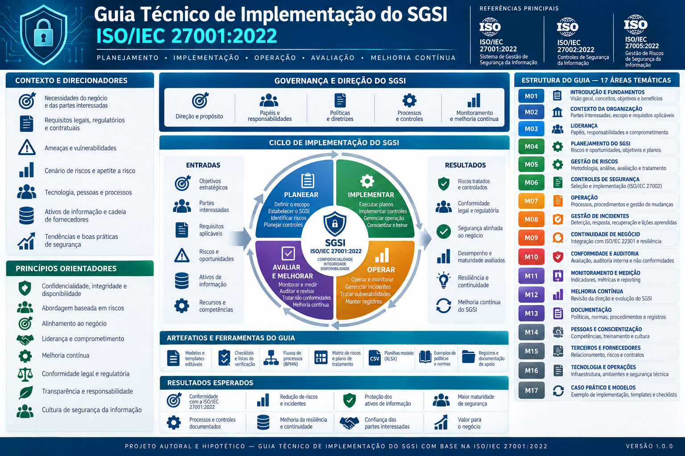

# Guia Técnico de Implementação do SGSI — ISO/IEC 27001:2022

**Projeto autoral de referência para planejar, implementar, operar, avaliar e melhorar um Sistema de Gestão de Segurança da Informação (SGSI), com foco na proteção efetiva dos ativos, processos, informações e serviços da organização. A ISO/IEC 27001 fornece a estrutura de requisitos do sistema de gestão, enquanto normas complementares e frameworks como os CIS Controls apoiam a definição e a implementação de medidas de segurança.**

> **Natureza do projeto:** conceitual, educacional e profissional. Este repositório não representa a implementação de um SGSI em uma organização real nem declara conformidade ou certificação organizacional.

## 1. Sobre o projeto

Desenvolvi este guia para organizar os elementos necessários à construção e à manutenção de um Sistema de Gestão de Segurança da Informação (SGSI), tendo a ISO/IEC 27001:2022 como referência para o sistema de gestão, mas sem limitar o propósito do trabalho à obtenção de certificação. O objetivo é orientar uma organização a estabelecer uma postura de segurança consistente, baseada em riscos, com medidas preventivas, detectivas, responsivas e de recuperação.

O repositório reúne documentos de referência, metodologia, orientações de governança e gestão de riscos, estrutura de controles, políticas, procedimentos e modelos de registros.

Uma preocupação central do trabalho é manter a relação entre requisitos, riscos, controles, documentos, responsabilidades e evidências. Essa rastreabilidade ajuda a entender por que cada artefato existe e como ele se conecta às demais partes do sistema de gestão.

O material destina-se a profissionais de Segurança da Informação, GRC (*Governance, Risk and Compliance*), gestão de riscos, auditoria, infraestrutura, operações de TI e consultoria.

## 2. Objetivos

- Explicar os requisitos da ISO/IEC 27001:2022 e sua aplicação na estruturação de um SGSI.
- Organizar uma metodologia de implementação por etapas, entregáveis e dependências.
- Desenvolver modelos documentais reutilizáveis, acompanhados de orientações de preenchimento e revisão.
- Relacionar requisitos normativos, riscos, controles, políticas, procedimentos e evidências.
- Estruturar a avaliação de riscos de Segurança da Informação e o Plano de Tratamento de Riscos.
- Orientar a elaboração da Declaração de Aplicabilidade (*Statement of Applicability* — SoA).
- Abordar controles organizacionais, de pessoas, físicos e tecnológicos.
- Definir práticas de monitoramento, medição, auditoria interna e melhoria contínua.
- Estabelecer uma abordagem de segurança que proteja informações, ativos, processos e serviços, reduzindo a exposição a ameaças e vulnerabilidades.
- Integrar medidas preventivas, detectivas, responsivas e de recuperação, considerando pessoas, processos, tecnologia, instalações e terceiros.
- Utilizar referências complementares, incluindo CIS Controls, para apoiar a seleção, priorização e evolução das salvaguardas técnicas.
- Apoiar a organização documental e, quando for um objetivo da organização, a preparação para auditorias externas de certificação.
- Apresentar exemplos conceituais que possam ser adaptados a diferentes contextos organizacionais.

## 3. Escopo

O guia contempla o ciclo de vida de um SGSI, desde a governança e o planejamento inicial até a implementação, operação, monitoramento, resposta a incidentes, recuperação e melhoria contínua. A preparação para certificação é uma possibilidade de avaliação externa do sistema, não a finalidade exclusiva do projeto.

Os domínios documentais incluem:

- Fundamentos do SGSI e referências técnicas.
- Governança e planejamento do projeto.
- Contexto organizacional, partes interessadas e definição do escopo.
- Liderança, política de Segurança da Informação e responsabilidades.
- Gestão de riscos e tratamento de riscos.
- Declaração de Aplicabilidade e justificativas de seleção dos controles.
- Estrutura de gestão dos controles de segurança.
- Políticas, procedimentos e informação documentada.
- Gestão de pessoas, competências e conscientização.
- Planejamento e controle operacional.
- Monitoramento, indicadores e avaliação de desempenho.
- Auditoria interna.
- Análise crítica pela direção, não conformidades e melhoria contínua.
- Preparação para certificação.
- Modelos, formulários, registros e instrumentos de apoio.
- Referências técnicas, glossário e orientações de uso das referências complementares.

A seleção e a aplicação de controles devem considerar o contexto, os riscos, os requisitos legais e contratuais e as decisões documentadas da organização responsável pelo SGSI. Os cenários apresentados neste projeto são conceituais, salvo indicação expressa em contrário.

## 4. Referências normativas e técnicas

Este projeto utiliza as referências abaixo como fundamento para estruturar o SGSI e orientar a implementação de medidas de segurança. A relação contempla todas as normas, referências técnicas e frameworks identificados como utilizados no desenvolvimento do guia. Para facilitar a leitura, estão organizados conforme sua finalidade.

### 4.1. Requisitos e controles do SGSI

| Referência | Aplicação no projeto |
|---|---|
| **ISO/IEC 27001:2022 + Emenda 1:2024** | Requisitos do Sistema de Gestão de Segurança da Informação. É a referência de requisitos auditáveis para certificação do SGSI. |
| **ISO/IEC 27002:2022** | Orientações para seleção, interpretação, desenho e implementação de controles de Segurança da Informação. |

### 4.2. Implementação e gestão de riscos

| Referência | Aplicação no projeto |
|---|---|
| **ABNT NBR ISO/IEC 27003:2020** | Orientações para implementação do SGSI e organização das atividades relacionadas às cláusulas da ISO/IEC 27001. |
| **ISO/IEC 27005:2022** | Orientações para gestão de riscos de Segurança da Informação, incluindo contexto, avaliação, tratamento, comunicação e monitoramento. |
| **ISO 31000:2018** | Princípios e diretrizes gerais para integrar a gestão de riscos à governança e aos processos organizacionais. |

### 4.3. Auditoria e certificação

| Referência | Aplicação no projeto |
|---|---|
| **ABNT NBR ISO/IEC 27007:2021** | Diretrizes específicas para auditoria de Sistemas de Gestão de Segurança da Informação. |
| **ISO 19011:2026** | Diretrizes gerais para auditoria de sistemas de gestão, incluindo programa de auditoria, condução e competência dos auditores. |
| **ISO/IEC 17021-1:2015** | Requisitos para organismos que realizam auditoria e certificação de sistemas de gestão. Referência de contexto para auditoria de terceira parte. |

### 4.4. Segurança em nuvem e privacidade

| Referência | Aplicação no projeto |
|---|---|
| **ISO/IEC 27017:2026** | Controles e orientações de segurança específicos para serviços em nuvem, incluindo responsabilidades entre clientes e provedores. O material de estudo anexado corresponde à edição ABNT de 2016. |
| **ISO/IEC 27018:2025** | Proteção de dados pessoais em serviços de nuvem pública, considerando o papel do provedor como processador. |
| **ISO/IEC 27701:2025** | Requisitos e orientações para Sistema de Gestão de Informações de Privacidade (PIMS), quando esse escopo fizer parte dos objetivos da organização. O material ABNT de 2019 foi tratado como referência histórica de estudo. |

### 4.5. Segurança cibernética e priorização de salvaguardas

| Referência | Aplicação no projeto |
|---|---|
| **CIS Critical Security Controls v8.1.2 (março de 2025)** | Framework de salvaguardas para identificar medidas técnicas, avaliar lacunas e priorizar iniciativas de defesa cibernética por meio dos grupos IG1, IG2 e IG3. |
| **A Roadmap to the CIS Critical Security Controls (novembro de 2024)** | Apoio ao planejamento da adoção progressiva dos CIS Controls e à organização de iniciativas de melhoria. |

Os CIS Controls complementam a análise de riscos e a determinação dos controles necessários. Sua aplicação não se limita aos controles com correspondência no Anexo A da ISO/IEC 27001: a organização pode adotar salvaguardas adicionais sempre que necessárias para tratar seus riscos.

### 4.6. Legislação brasileira

| Referência | Aplicação no projeto |
|---|---|
| **Lei nº 13.709/2018 — Lei Geral de Proteção de Dados Pessoais (LGPD)** | Referência legal para operações de tratamento de dados pessoais, direitos dos titulares e medidas de segurança, quando aplicável. |

### 4.7. Critérios de interpretação

As referências possuem naturezas e finalidades distintas. A ISO/IEC 27001 estabelece os requisitos do SGSI; as demais normas oferecem orientações, tratam de escopos específicos ou estabelecem requisitos próprios para outros sistemas de gestão. Os CIS Controls fornecem salvaguardas técnicas priorizadas, enquanto a LGPD constitui obrigação legal quando aplicável.

A certificação do SGSI, quando pretendida, é avaliada com base nos requisitos aplicáveis da ISO/IEC 27001:2022, considerada com a Emenda 1:2024, e nas evidências da organização. As demais referências apoiam a implementação e a operação da segurança, mas não constituem requisitos adicionais para essa certificação.

A relação acima identifica as fontes utilizadas no desenvolvimento do guia; não significa que todos os seus requisitos ou controles sejam aplicáveis a qualquer organização. A seleção depende do contexto, dos riscos, dos ativos, das obrigações legais e contratuais e dos objetivos de segurança.

Para consultar a finalidade, as limitações de edição e o uso de cada referência, consulte [Referências Técnicas e Normativas do SGSI](docs/17-referencias-e-glossario/referencias-tecnicas-e-normativas.md) e [Uso das Referências Complementares de Segurança da Informação](docs/17-referencias-e-glossario/uso-das-referencias-complementares-de-seguranca-da-informacao.md).

## 5. Metodologia de implementação

Organizei a metodologia em 17 domínios documentais. Eles representam a forma como distribuí os conteúdos do guia; não devem ser confundidos com etapas ou fases obrigatórias de implantação. Em uma aplicação real, a sequência de trabalho precisa considerar os requisitos, as dependências, as decisões de governança e as evidências necessárias.

### Domínios documentais

1. Fundamentos do SGSI.
2. Governança e planejamento do projeto.
3. Contexto organizacional e escopo.
4. Liderança, responsabilidades e autoridades.
5. Gestão de riscos de Segurança da Informação.
6. Declaração de Aplicabilidade.
7. Plano de Tratamento de Riscos.
8. Gestão dos controles de segurança.
9. Políticas e procedimentos.
10. Pessoas e conscientização.
11. Operação do SGSI.
12. Monitoramento, indicadores e avaliação.
13. Auditoria interna.
14. Análise crítica pela direção e melhoria contínua.
15. Preparação para certificação.
16. Modelos e registros.
17. Referências técnicas e glossário.

A sequência é uma estrutura de organização do conteúdo. Ela não substitui o planejamento específico de uma implementação real, que deve considerar o contexto e as necessidades da organização.

## 6. Rastreabilidade normativa e evidências

A rastreabilidade é um princípio central do projeto. Sempre que pertinente, os documentos técnicos devem estabelecer relações entre os requisitos do SGSI, os riscos identificados, os controles selecionados, as responsabilidades e as evidências correspondentes.

Os artefatos devem considerar, conforme sua finalidade:

- Referência normativa e requisito ou controle relacionado.
- Objetivo e interpretação técnica.
- Critérios de aplicabilidade.
- Responsabilidades e autoridades.
- Procedimentos, registros e evidências esperadas.
- Interfaces com outros processos e documentos.
- Critérios de avaliação, monitoramento e revisão.
- Premissas, exceções e limitações de aplicabilidade.
- Histórico de revisão e controle de versão.

A existência de uma política, procedimento, plano ou formulário não constitui, isoladamente, prova de implementação eficaz. A avaliação depende da execução dos processos e da existência de evidências adequadas ao contexto analisado.

Os modelos disponibilizados no repositório são instrumentos de apoio. Seu preenchimento, aprovação, aplicação e manutenção dependem de quem os utilizar em uma implementação real.

## 7. Natureza conceitual e limites de utilização

Este projeto é autoral e possui finalidade técnica, educacional e de demonstração de conhecimento profissional.

Cenários, nomes de cargos, responsabilidades, metas, orçamentos, registros e aprovações utilizados em exemplos devem ser considerados hipotéticos, salvo quando houver indicação expressa e evidência que sustente outra condição.

Os documentos devem ser adaptados ao contexto organizacional, aos riscos, aos requisitos legais e contratuais e à estrutura de governança de cada organização.

O guia apoia o planejamento e a preparação para auditorias, mas não garante certificação, não substitui a consulta às normas oficiais e não constitui parecer jurídico ou garantia de conformidade.

A certificação do SGSI, quando pretendida, é avaliada com base nos requisitos aplicáveis da ISO/IEC 27001:2022, considerada com a Emenda 1:2024, e nas evidências da organização avaliada. Esse recorte de certificação não limita o alcance do projeto: a implementação de segurança deve considerar também os riscos e as necessidades reais da organização, inclusive medidas que ultrapassem o conjunto de controles de referência do Anexo A. Normas complementares e frameworks como os CIS Controls podem apoiar o desenho e a priorização dessas medidas, sem substituir os requisitos da ISO/IEC 27001 para a certificação.

A publicação de documentos neste repositório demonstra a elaboração de material de referência. Não demonstra, por si só, que os processos ou controles descritos tenham sido implementados em uma organização.

## 8. Organização do repositório

O conteúdo está organizado em diretórios temáticos, com desenvolvimento progressivo dos documentos.

| Diretório | Conteúdo |
|---|---|
| `docs/01-fundamentos/` | Fundamentos, conceitos e orientação introdutória sobre o SGSI. |
| `docs/02-governanca-do-projeto/` | Documento mestre, planejamento e governança da implementação. |
| `docs/03-contexto-e-escopo/` | Contexto organizacional, partes interessadas, escopo e política de Segurança da Informação. |
| `docs/04-lideranca-e-responsabilidades/` | Papéis, responsabilidades e autoridades do SGSI. |
| `docs/05-gestao-de-riscos/` | Metodologia de gestão de riscos de Segurança da Informação. |
| `docs/06-declaracao-de-aplicabilidade/` | Declaração de Aplicabilidade (*SoA*) e justificativas pertinentes. |
| `docs/07-plano-de-tratamento/` | Planejamento do tratamento de riscos. |
| `docs/08-controles-de-seguranca/` | Estrutura de gestão dos controles de segurança. |
| `docs/09-politicas-e-procedimentos/` | Estrutura de políticas e procedimentos de Segurança da Informação. |
| `docs/10-pessoas-e-conscientizacao/` | Gestão de pessoas, competências e conscientização. |
| `docs/11-operacao-do-sgsi/` | Planejamento e controle operacional do SGSI. |
| `docs/12-monitoramento-e-indicadores/` | Monitoramento, medição, análise e avaliação do SGSI. |
| `docs/13-auditoria-interna/` | Metodologia de auditoria interna do SGSI. |
| `docs/14-analise-critica-e-melhoria/` | Análise crítica pela direção e melhoria contínua. |
| `docs/15-certificacao/` | Orientações para preparação e processo de certificação. |
| `docs/16-modelos-e-registros/` | Modelos de documentos, formulários e registros reutilizáveis. |
| `docs/17-referencias-e-glossario/` | Referências técnicas, glossário e uso das referências complementares. |
| `matrizes/` | Diretório previsto para matrizes consolidadas de apoio. |
| `diagramas/` | Diretório previsto para fluxos, dependências e representações visuais. |
| `exemplos/` | Diretório previsto para cenários hipotéticos e exemplos preenchidos. |

A existência de um diretório no planejamento não significa que ele já esteja criado ou preenchido. A estrutura deve ser atualizada conforme novos artefatos forem publicados.

O índice documental em [`docs/README.md`](docs/README.md) apresenta a navegação pelos documentos técnicos e deve ser consultado para localizar os conteúdos já disponibilizados.

## 9. Critérios de qualidade

A elaboração e a revisão dos artefatos consideram os seguintes critérios:

- Consistência com as referências normativas citadas.
- Precisão técnica e clareza das orientações.
- Rastreabilidade entre requisitos, riscos, controles e evidências.
- Coerência entre documentos relacionados.
- Identificação explícita de premissas e cenários hipotéticos.
- Separação entre requisitos normativos, recomendações e decisões de projeto.
- Controle de versão e histórico de alterações.
- Reutilização prática, com instruções para adaptação.
- Ausência de declarações de implementação, eficácia ou aprovação sem fundamento documental.
- Atualização dos índices e dos links internos quando houver criação ou alteração de documentos.

## 10. Situação do projeto

O repositório continua em desenvolvimento. A revisão documental `v1.1.0` registra a atualização das referências normativas, o alinhamento das edições e os ajustes de hierarquia entre requisitos do SGSI, diretrizes e extensões. A tag de release correspondente ainda precisa ser criada no GitHub. Os documentos e modelos seguem sujeitos a revisão, ampliação e ajustes de coerência.

A publicação de um artefato representa a disponibilização de conteúdo documental no repositório. Não equivale a uma validação independente de conformidade, nem comprova que os controles descritos tenham sido implementados ou testados em uma organização real.

O desenvolvimento continua por etapas, com revisão técnica, atualização do índice documental e verificação progressiva da coerência entre os artefatos.

Os temas ainda não publicados ou identificados como planejados devem ser tratados como pendentes, e não como entregáveis concluídos.

## 11. Aviso sobre normas e propriedade intelectual

As normas técnicas citadas são publicações de seus respectivos titulares e organismos de normalização. Sua referência neste projeto não implica endosso, afiliação ou aprovação institucional.

Para aplicação formal, auditorias ou decisões de conformidade, consulte as edições oficiais vigentes das normas e a legislação aplicável.

O conteúdo deste repositório é um material autoral de referência. A utilização em uma organização exige análise crítica, adaptação ao contexto e validação pelos responsáveis competentes.

---

**Projeto:** Guia Técnico de Implementação do SGSI — ISO/IEC 27001:2022  
**Autor:** José Eduardo Moura Cardozo  
**Status:** Em desenvolvimento contínuo — revisão documental `v1.1.0` (tag de release pendente)  
**Natureza:** Projeto autoral, conceitual e educacional

## 12. Direitos autorais e condições de uso

Este repositório contém material autoral de referência. O acesso público destina-se à consulta e à avaliação profissional e não concede uma licença geral para reprodução, redistribuição, adaptação ou exploração comercial dos materiais originais.

Consulte o arquivo [LICENSE.md](LICENSE.md) para conhecer o aviso de direitos autorais, os usos permitidos, as restrições aplicáveis e a distinção entre conteúdo autoral e materiais de terceiros, incluindo normas técnicas citadas.

As normas ISO/IEC e outras referências mencionadas permanecem sujeitas aos direitos de seus respectivos titulares. A publicação deste projeto não implica afiliação, endosso ou autorização para reproduzir conteúdo protegido dessas fontes.

A publicação pública no GitHub continua sujeita aos Termos de Serviço da plataforma, inclusive às permissões necessárias para visualizar e fazer *fork* do repositório dentro do GitHub.

## 13. Referências complementares

Além das referências principais, incluí um documento para orientar o uso de materiais complementares sobre implementação do SGSI, auditoria, gestão de riscos, serviços em nuvem, privacidade e CIS Controls. Essas referências são parte da abordagem técnica de implementação e proteção da organização, não apenas de sua preparação para certificação. A seleção das referências considera a edição mais atual disponível, sem misturar conteúdos de versões distintas.

Consulte [Uso das Referências Complementares de Segurança da Informação](docs/17-referencias-e-glossario/uso-das-referencias-complementares-de-seguranca-da-informacao.md). O documento diferencia requisitos normativos, orientações técnicas e materiais de estudo, além de registrar limitações de edição e licença.
